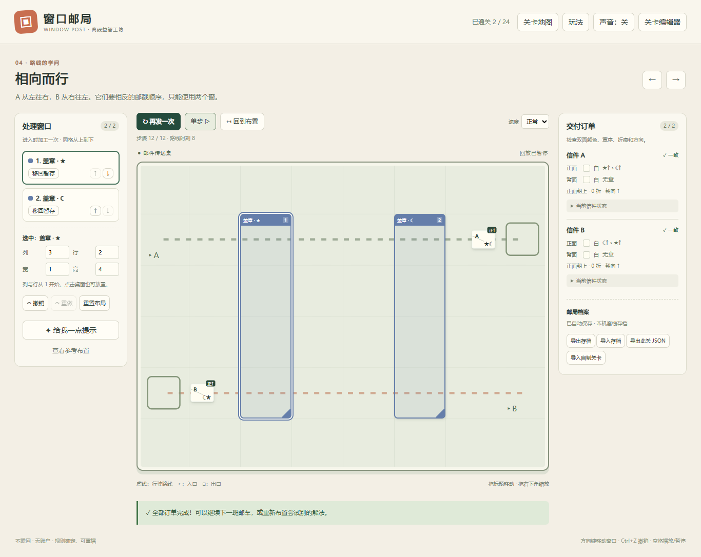

# 窗口邮局 · Window Post

把窗口摆成一条小小的邮件加工线。

信件沿不同路线移动，进入窗口时染色、盖章、折叠、擦除、翻面或旋转。调整窗口的位置、大小和层级，让每封信抵达出口时都符合订单。反向路线会颠倒工艺先后；绕回来的信还会第二次进入同一扇窗。



## 立即开始

1. 下载并完整解压游戏文件。
2. Windows 双击 **`Start.cmd`**，或在 Edge / Chrome / Firefox 中打开 **`index.html`**。
3. 不需要安装 Node.js、登录、联网或运行后台服务。请保留 `src` 文件夹与 `index.html` 的相对位置。

浏览器通常会将进度存到本机。隐私模式、文件访问策略、换浏览器或移动文件位置可能使原存档无法读取；游戏内的 **导出存档 / 导入存档** 可以跨位置备份恢复。存档包含自制关卡。

## 游戏内容

- **24 关、6 个章节**：基础覆盖、邮戳顺序、折痕、双面加工、转弯、相向路线、重入和组合挑战。
- **6 种加工窗口**：染色、盖章、折叠、擦除、翻面、旋转。
- 拖动、缩放、精确坐标、工艺顺序调整、暂存窗口。
- 自动播放、暂停、逐步查看移动和加工、速度调整、重试。
- 布局撤销与重做、提示、参考解法、自动保存、关卡地图。
- 内置关卡编辑器：绘制相邻格路线、管理工具和信件、从参考布局生成订单、保存并导出 JSON 分享。
- 所有内置关卡都带有经过自动验证的参考解法，目标还用独立编写的设计断言核对。

这是一个完整的离线浏览器游戏。窗口都在游戏内部，不控制其他程序，也不访问屏幕或真实邮件。

## 一分钟玩法

1. 选择左侧窗口，点击“放上桌”，或点击桌面放置。
2. 拖窗口顶部移动，拖右下角改变尺寸。也可在左侧输入列、行、宽、高。
3. 查看右侧每封信的目标：正背面颜色、邮戳顺序、朝上面、折痕和方向都需要一致。
4. 点击 **发件**；使用 **单步** 看清每次移动和加工。
5. 不匹配时展开“当前信件状态”，回到布置调整。

### 加工规则

每封信按照网格路径独立前进。进入一扇窗口时执行一次工艺；持续位于窗内不会重复。离开再进入会重新执行。入口格也可以触发加工。

同一步进入多扇重叠窗口时，**左侧列表从上到下**决定加工顺序。不同位置的窗口以实际经过的时间为准，因此反向行驶可以产生相反顺序。点击选中窗口不会偷偷改变层级。

| 窗口 | 效果 |
| --- | --- |
| 染色 | 覆盖当前朝上面的颜色，不擦除邮戳 |
| 盖章 | 向当前面追加邮戳，记录盖下时的方向，章序参与验收 |
| 折叠 | 折痕加一，最多两折；不影响路径或后续加工 |
| 擦除 | 当前面恢复白色并清除该面的全部邮戳 |
| 翻面 | 切换正面 / 背面朝上 |
| 旋转 | 朝向顺时针加 90°；既有邮戳方向不变 |

快捷键：方向键移动选中窗口；Ctrl+Z 撤销；Ctrl+Shift+Z 重做；空格播放 / 暂停。输入框和弹窗内不会触发这些快捷键。

## 自制关卡

点击 **关卡编辑器**，会复制当前关卡，不改动内置关卡。

1. 改标题，添加、删除或修改加工窗口。
2. 选择信件，点“重画路线”，点击入口再依次点击相邻格；“接着画路线”可延长路线。可回头，路径长度为 2–60 格。
3. 添加 / 删除信件并布置窗口。最多 24 封信、12 扇窗。
4. 点击 **生成订单并保存**：当前布局成为参考解法，其运行结果成为交付订单。窗口会回到暂存状态，以便从头挑战。
5. 点 **导出此关 JSON** 分享，另一位玩家用 **导入自制关卡** 打开。

编辑器保留复制关卡的原始信件状态；新加信件为双面白纸。当前图形编辑器使用所复制关卡的网格大小。JSON 允许 3–10 列、3–8 行的网格。最多本地保存 30 个自制关卡，建议定期导出备份。

参考解法可查看但不会直接计入通关，仍需发件运行。关卡没有唯一解要求，也没有计时压力。

## 开发与测试

游戏本体零依赖。规则测试只需要 Node.js 18+：

```sh
npm test
```

需要本地 HTTP 开发服务时：

```sh
npm start
# http://127.0.0.1:4317
```

浏览器端到端验收（Node.js 20+）：

```sh
npm ci
npx playwright install chromium
npm run test:ui
```

Windows 已安装 Edge 时，可设置环境变量 `PLAYWRIGHT_CHANNEL=msedge` 使用它。UI 测试会自动启动并关闭测试服务器，截图与结果位于 `artifacts/`。CI 在 Windows / Linux 跑规则测试，在 Linux Chromium 跑浏览器流程。

规则模块 `src/engine.js` 不依赖 DOM；`src/levels.js` 提供关卡；`src/app.js` 负责界面与本机存档。详细验收范围和限制见 [测试报告](docs/TEST_REPORT.md)。

## 许可

[MIT](LICENSE)。素材与依赖说明见 [ASSETS.md](ASSETS.md)。
